# Smart School System

A web-based school management system built with **Django**, with an **AI early-warning model** that flags students at risk of failing, and **face recognition** for student login and class attendance.

> Graduation project, rebuilt and extended by Faisal Ahmed.

## Features

| Role | What they can do |
|------|------------------|
| **Admin** | Manage students, teachers, parents, courses and enrolments; see the "Students at risk" overview |
| **Teacher** | Weekly schedule, course materials, assignments and grading, quizzes, course announcements, face-based attendance sessions, final grades, **AI risk overview of the students of each course** |
| **Student** | Dashboard, timetable, courses, homework upload, quizzes, grades with attendance %, face login, AI risk report |
| **Parent** | Read-only view of their child's progress, attendance and risk level |

## AI components

### 1. Student risk model (XGBoost)
- Features: normalised term work, cumulative GPA, passed credit hours, level.
- Label: the student failed / was absent in a course.
- Evaluated with a **split by student** (no student appears in both train and test), so the numbers are not inflated:

| Metric | Value |
|--------|-------|
| Accuracy | 0.876 |
| Recall (at-risk class) | 0.825 |
| ROC-AUC | 0.951 |

- Re-run it yourself: `python evaluate_risk_model.py` (writes `model_evaluation.txt`).
- Risk levels: `> 60 %` critical, `> 30 %` caution.
- A small manual calibration rule lowers the score for students with strong term work.
- The model was trained on anonymised records that are **not** published in this repository.

### 2. Face recognition (OpenCV LBPH)
- Haar-cascade face detection, then LBPH matching (distance threshold configurable: `FACE_THRESHOLD` in `settings.py`, default 75, lower = stricter).
- Enrolment stores up to 30 face crops per student; login and attendance compare against that student only (1:1).
- Attendance always uses the **logged-in** student, never an id sent by the browser.
- Limitation: LBPH is a classic method; a printed photo can fool it. For production use a liveness check.

## Security
- Role-based access control middleware (default deny, owners only see their own data).
- Hashed passwords (old plain-text passwords upgrade automatically at first login).
- CSRF protection on all forms and APIs; login lock after 5 wrong passwords (5 minutes).

## Tech stack
Python, Django 5.2, SQLite, XGBoost, scikit-learn, OpenCV (contrib), HTML/CSS/JS.

## Run it
```bash
python -m venv venv
venv\Scripts\activate            # Windows
pip install -r requirements.txt
cd web
python manage.py migrate
python manage.py seed_demo --reset   # demo data, password: demo1234
python manage.py runserver
python manage.py test                # automated tests
```

### Demo logins (password for all: `demo1234`)

| Role | ID | Notes |
|------|----|-------|
| Admin | see `seed_demo.py` | full access |
| Teacher | 101 | Math 1, can post announcements and open the AI "Students at risk" page |
| Student | 1001 | strong student, Math 1 |
| Student | **1013** | **Faisal Ahmed**, enrolled in Data Structures, Databases and AI & ML |
| Parent | **2009** | **the parent of Faisal (1013)**, read-only view of his courses, grades, attendance and risk |

Students are 1001-1013, teachers 101-110, parents 2001-2009 (not every student has a parent account; Faisal's parent is the last one). Parents see only their own child and cannot take quizzes or mark attendance.

## Screenshots

| Home | Admin dashboard |
|------|-----------------|
| 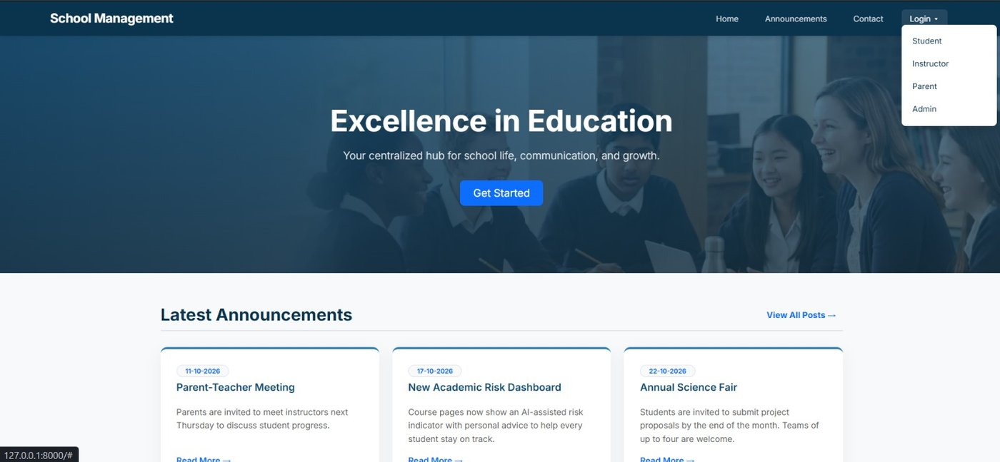 | 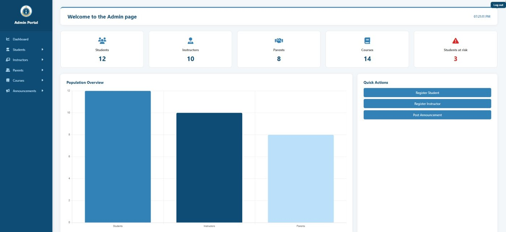 |

**AI risk indicator** (same course, two students: a strong one and one with poor attendance and scores)

| Low risk | High risk |
|----------|-----------|
| 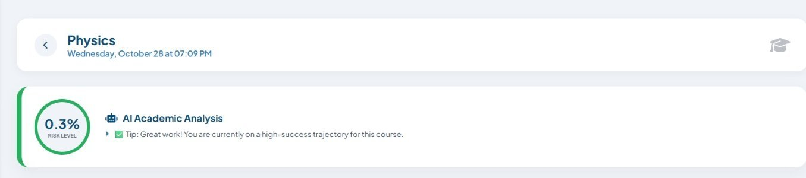 | 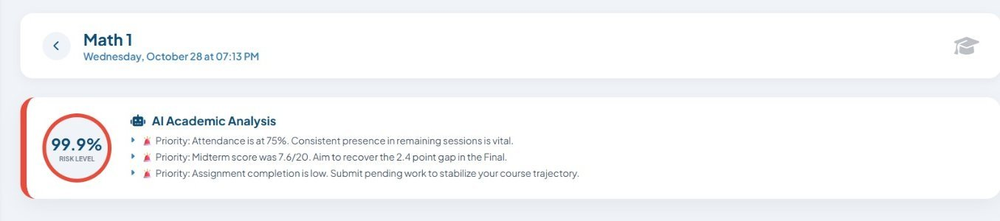 |

| Teacher dashboard | Parent dashboard |
|-------------------|------------------|
| 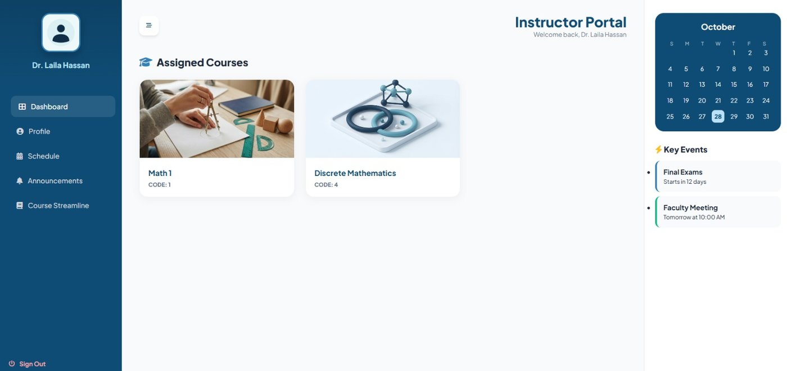 | 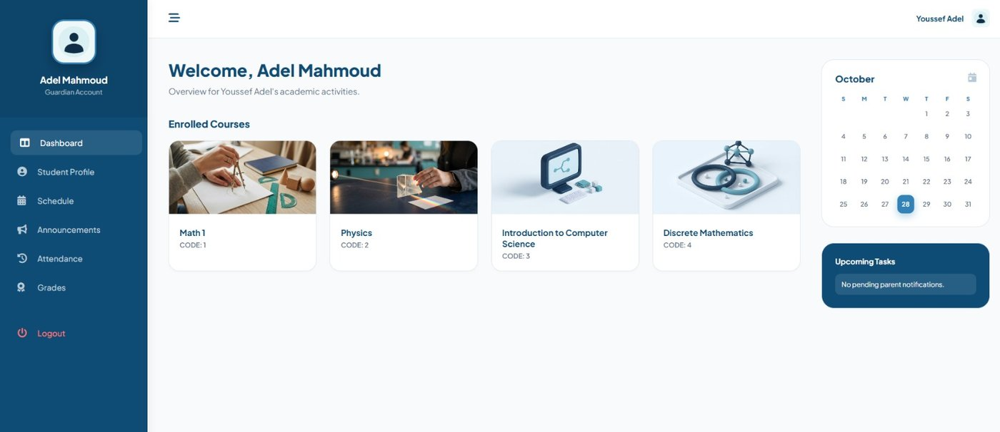 |

| Student courses | Weekly timetable |
|-----------------|------------------|
| 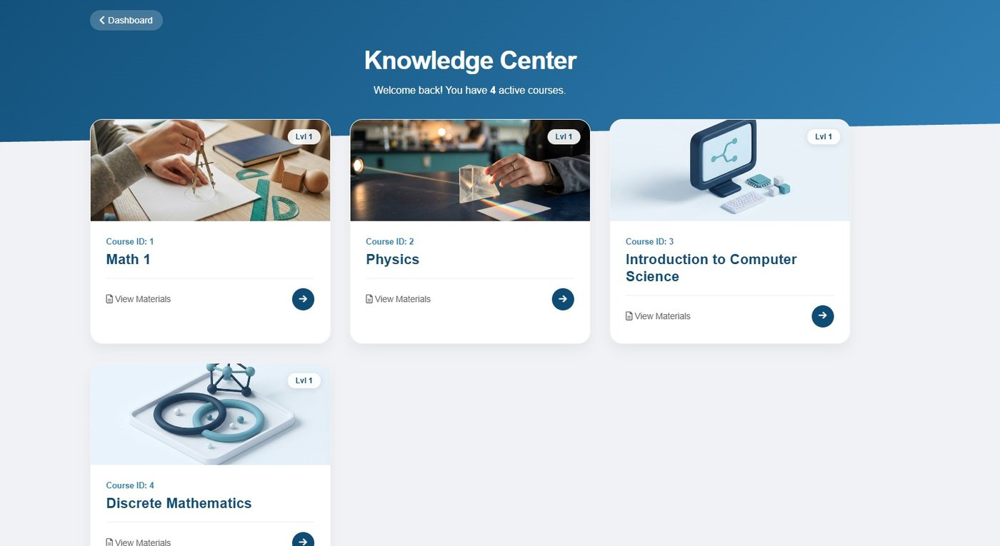 | 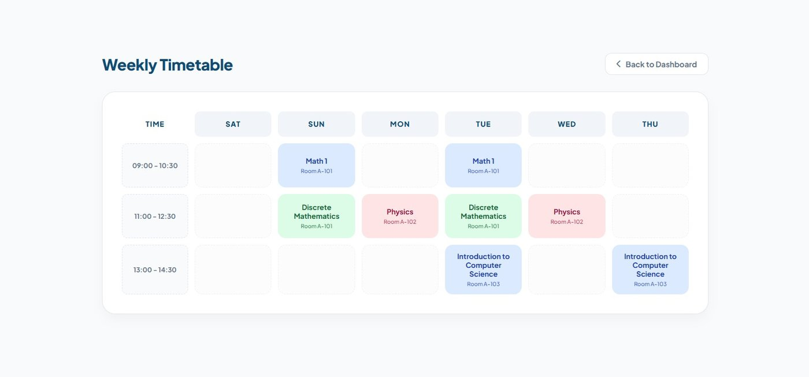 |

| Academic transcript | Course catalog (admin) |
|---------------------|------------------------|
| 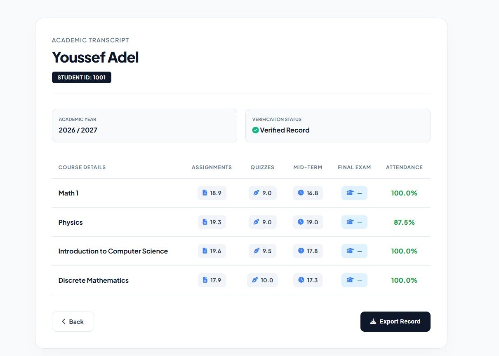 | 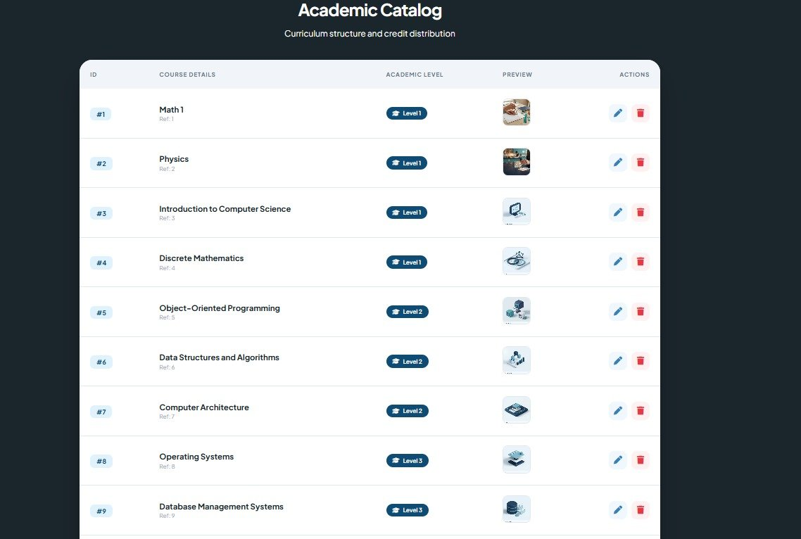 |

**New: AI risk overview for teachers and course announcements**

| Teacher course menu | Students at risk (XGBoost) |
|---------------------|----------------------------|
| 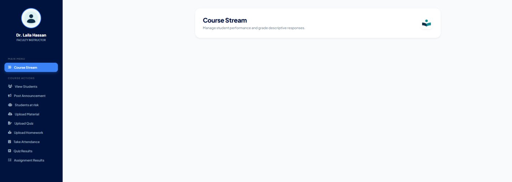 | 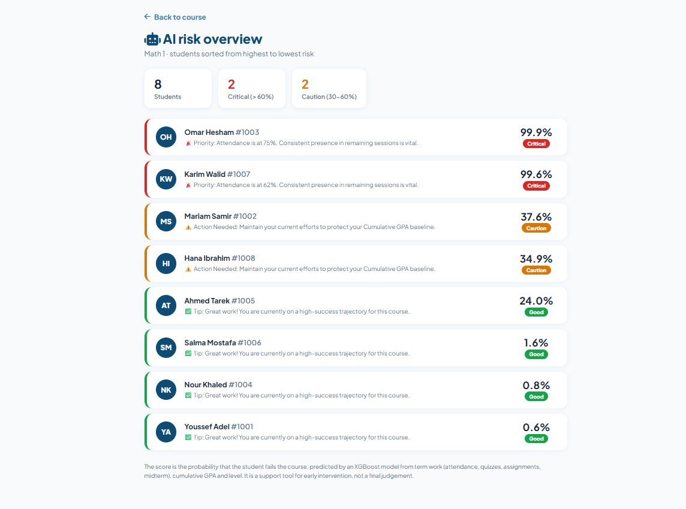 |

| Post an announcement (PDF / video) | What students see |
|------------------------------------|-------------------|
| 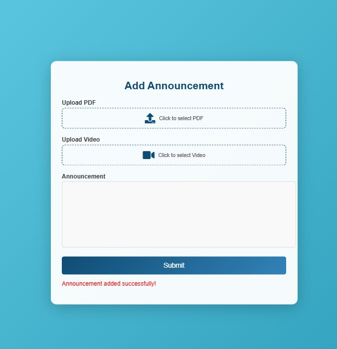 | 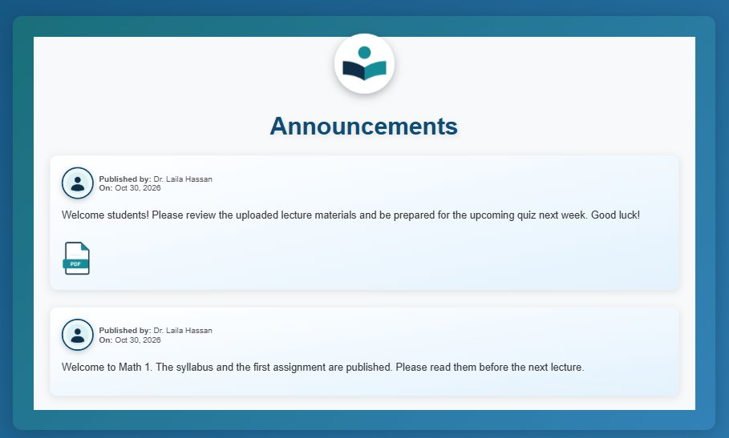 |

**Demo family: student "Faisal Ahmed" (ID 1013) and his parent (ID 2009).** Faisal is enrolled in Data Structures, Databases and AI & ML; the parent sees the same courses read-only.

| Dashboard | Course page with personal risk score |
|-----------|--------------------------------------|
| 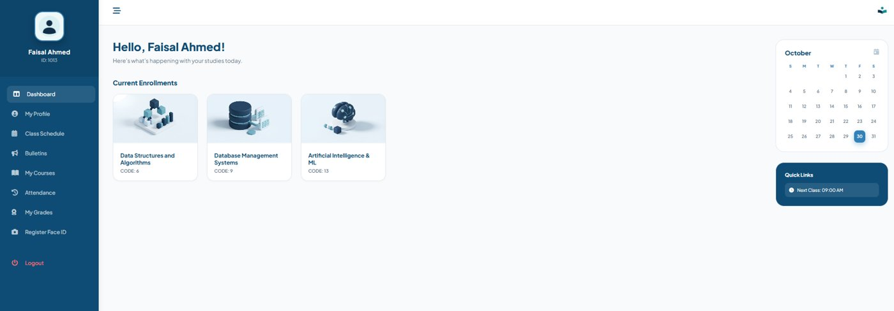 | 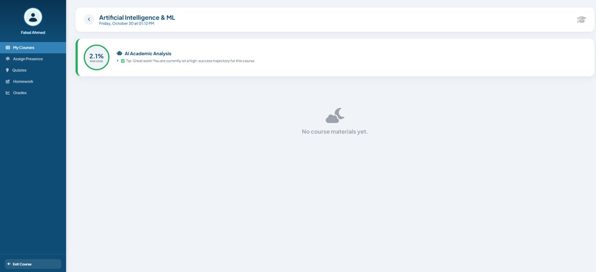 |

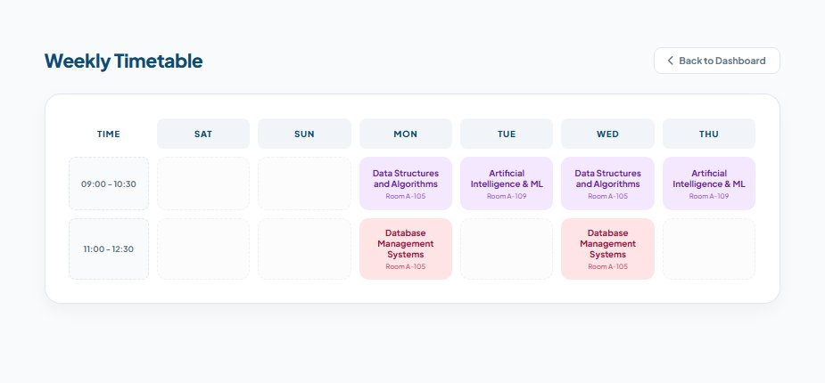

All data shown is fictional demo data created by `python manage.py seed_demo --reset`.

## Configuration
Settings are read from environment variables, with safe defaults for local development:

| Variable | Meaning | Default |
|----------|---------|---------|
| `DJANGO_SECRET_KEY` | Django secret key. **Set your own for any real deployment.** | development key |
| `DJANGO_DEBUG` | `1` = debug on, `0` = off | `1` |
| `DJANGO_ALLOWED_HOSTS` | comma separated host names | `127.0.0.1,localhost` |

## Known limitations
- Much of the data access still uses raw SQL; migrating to the Django ORM is planned.
- The face recognizer has no liveness detection.

## Credits
Started as a team graduation project at FCAI (Data Science & AI departments).
Extended by Faisal Ahmed: access control and password hashing, risk-model evaluation,
face-recognition hardening, course announcements, automated tests and documentation.
